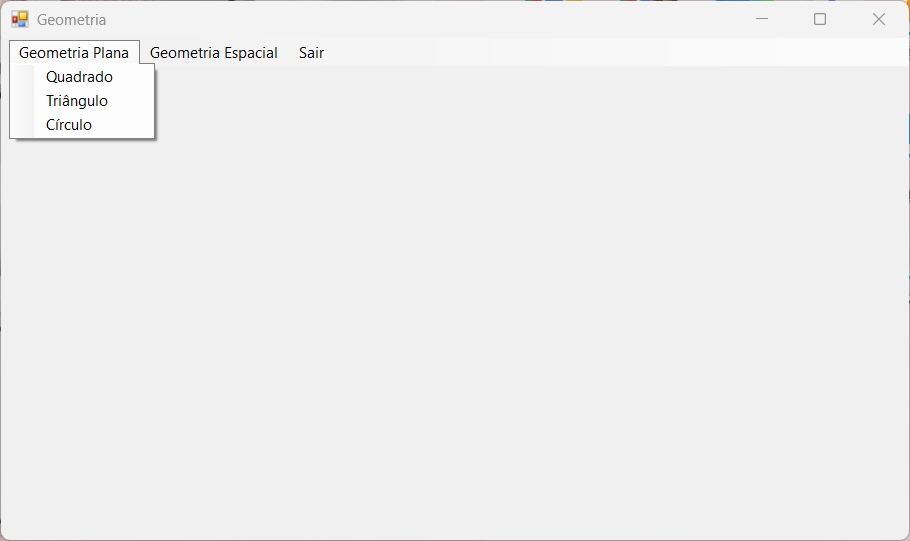
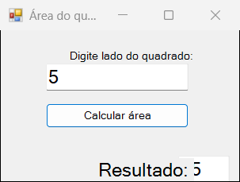
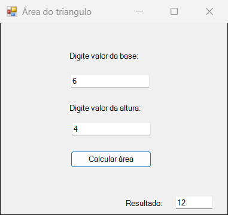
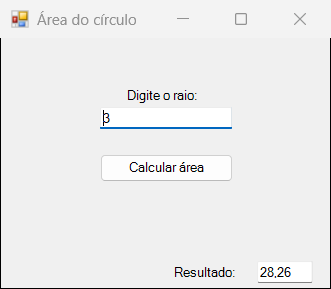
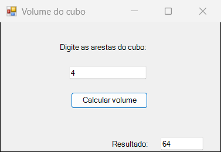
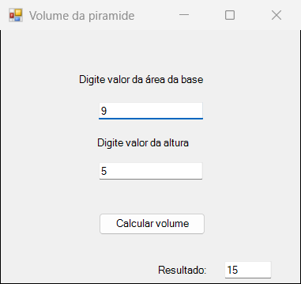
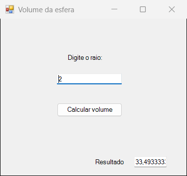
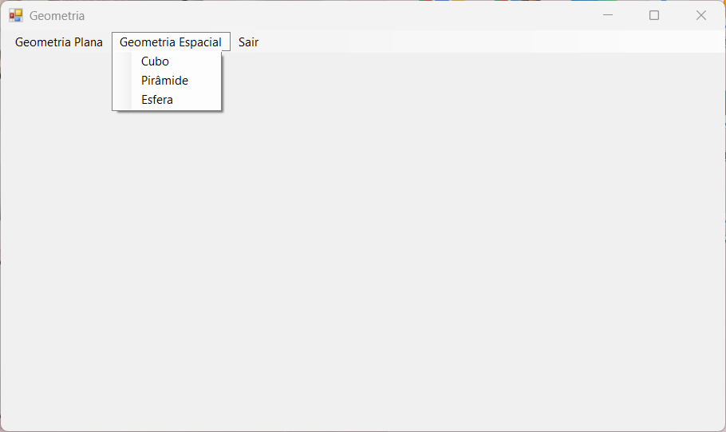

<div align="center">

# Calculadora Geométrica

Aplicativo desktop em **C# com Windows Forms** que calcula a área de figuras planas e o volume de sólidos geométricos.




</div>

## Sobre

Projeto do meu curso técnico integrado ao ensino médio. Usei a calculadora para praticar o que estudava nas aulas de C#: formulários e eventos do Windows Forms, conversão de tipos e a classe `Math`.

A janela principal tem um menu dividido em **Geometria Plana** e **Geometria Espacial**. Cada figura abre uma janela própria (modal), onde você digita as medidas e clica em calcular.

## Funcionalidades

| Menu | Figura | Você informa | Resultado |
|---|---|---|---|
| Geometria Plana | Quadrado | lado | área = lado² |
| Geometria Plana | Triângulo | base e altura | área = (base × altura) / 2 |
| Geometria Plana | Círculo | raio | área = π × raio² |
| Geometria Espacial | Cubo | aresta | volume = aresta³ |
| Geometria Espacial | Pirâmide | área da base e altura | volume = (área da base × altura) / 3 |
| Geometria Espacial | Esfera | raio | volume = 4/3 × π × raio³ |

## Telas

<table>
  <tr>
    <td align="center"><br><sub>Quadrado: lado 5 → 25</sub></td>
    <td align="center"><br><sub>Triângulo: base 6, altura 4 → 12</sub></td>
    <td align="center"><br><sub>Círculo: raio 3 → 28,26</sub></td>
  </tr>
  <tr>
    <td align="center"><br><sub>Cubo: aresta 4 → 64</sub></td>
    <td align="center"><br><sub>Pirâmide: base 9, altura 5 → 15</sub></td>
    <td align="center"><br><sub>Esfera: raio 2 → 33,49…</sub></td>
  </tr>
</table>

<p align="center"></p>

## Como funciona

A janela principal (`Formgeo`) abre cada calculadora com `ShowDialog()`. Em cada janela, o clique no botão lê os campos, faz a conta e mostra o resultado:

```csharp
private void button1_Click(object sender, EventArgs e)
{
    double raio, resultado;
    raio = Convert.ToInt16(caixacirculo.Text);
    resultado = 3.14 * Math.Pow(raio, 2);
    resultadocirculo.Text = resultado.ToString();
}
```

## Como executar

**Com o Visual Studio:** abra `geometria_talia_ccharp.sln` e pressione `F5`.

**Sem o Visual Studio:** o Windows já vem com o compilador C# do .NET Framework 4. No PowerShell:

```powershell
cd geometria
C:\Windows\Microsoft.NET\Framework64\v4.0.30319\csc.exe -target:winexe -out:geometria.exe -r:System.Windows.Forms.dll -r:System.Drawing.dll *.cs Properties\*.cs
.\geometria.exe
```

> O executável em `geometria/bin/Debug` foi gerado para o .NET Framework 3.5. No Windows 10/11 ele pode pedir a instalação desse recurso; compilar com o comando acima evita isso.

## Estrutura

```
geometria/
├── Program.cs              # ponto de entrada
├── Formgeo.cs              # janela principal com o menu
├── quadrado.cs  triangulo.cs  circulo.cs
├── cubo.cs  piramide.cs  esfera.cs
└── *.Designer.cs           # layout das janelas, gerado pelo Visual Studio
```

## O que eu melhoraria hoje

- **Validar a entrada:** hoje, letras ou um campo vazio fecham o programa com erro. `double.TryParse` resolveria e permitiria mostrar uma mensagem amigável.
- **Aceitar decimais e números maiores:** `Convert.ToInt16` só aceita inteiros até 32.767.
- **Usar `Math.PI`** no lugar de 3,14, para resultados mais precisos.
- **Corrigir a divisão inteira do triângulo:** base 5 e altura 3 resultam em 7, e não em 7,5.
- **Tirar `bin/` e `obj/` do repositório** com um `.gitignore`.

## Autora

Feito por **Talia Lino**: [LinkedIn](https://www.linkedin.com/in/talia-lino-de-oliveira/) · [GitHub](https://github.com/talialino)
